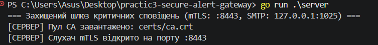
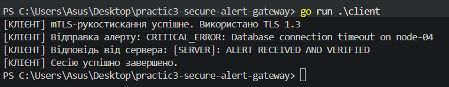
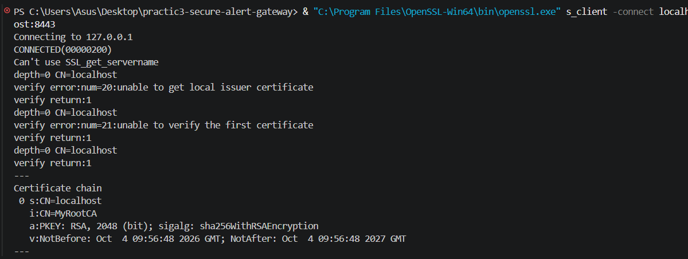
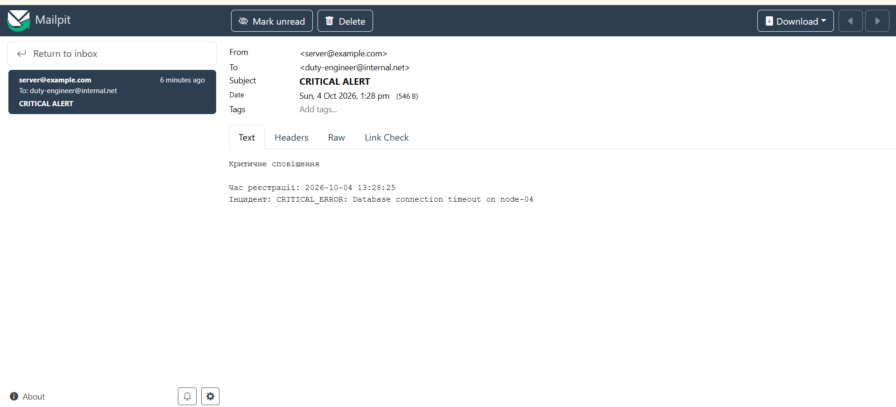

# Secure Alert Gateway

Практична робота №3 з курсу Go.

## Тема

**Налаштування захищеного каналу mTLS та протоколу SMTP**

## Мета роботи

Розробити захищений шлюз критичних сповіщень, який:

- використовує PKI та X.509 сертифікати;
- забезпечує взаємну TLS-аутентифікацію (mTLS);
- використовує TLS 1.3;
- приймає критичні повідомлення від клієнта;
- передає повідомлення електронною поштою через SMTP;
- використовує Mailpit для тестування SMTP.

Практична робота виконана для **Level 1 та Level 2**. Level 3 не реалізовувався.

---

## Технології

- Go 1.22+
- `crypto/tls`
- `crypto/x509`
- `net/smtp`
- OpenSSL
- Docker
- Mailpit
- PowerShell
- Git

---

## Структура проєкту

```text
practic3-secure-alert-gateway/
│
├── certs/
│   ├── ca.crt
│   ├── client.crt
│   └── server.crt
│
├── client/
│   └── main.go
│
├── email/
│   └── main.go
│
├── server/
│   └── main.go
│
├── screenshots/
│   ├── 01-certificates.png
│   ├── 02-server.png
│   ├── 03-client.png
│   ├── 04-mailpit.png
│   └── 05-unauthorized.png
│
├── generate_certs.ps1
├── .gitignore
├── go.mod
└── README.md
```

> Приватні ключі `.key` та тимчасові файли сертифікатів не додаються до Git-репозиторію.

---

# Level 1 — mTLS

## 1. Ініціалізація проєкту

Проєкт створено за допомогою:

```powershell
go mod init secure-alert-gateway
```

Перевірка залежностей:

```powershell
go mod tidy
```

Перевірка компіляції:

```powershell
go build ./...
```

---

## 2. Створення сертифікатів

Для створення PKI використовується OpenSSL.

Сертифікати генеруються PowerShell-скриптом:

```powershell
.\generate_certs.ps1
```

Створюються:

- Root CA — `ca.crt` / `ca.key`
- Server certificate — `server.crt` / `server.key`
- Client certificate — `client.crt` / `client.key`

Server certificate має SAN:

```text
DNS:localhost
IP Address:127.0.0.1
```

Перевірка сертифіката:

```powershell
openssl x509 -in certs/server.crt -noout -text
```

## 3. Запуск mTLS-сервера

У першому PowerShell запускається сервер:

```powershell
go run .\server
```

Сервер запускається на:

```text
127.0.0.1:8443
```

TLS налаштований з такими параметрами:

```go
ClientAuth: tls.RequireAndVerifyClientCert
MinVersion: tls.VersionTLS13
```

Це означає, що сервер вимагає від клієнта дійсний сертифікат, підписаний довіреним CA.

### Запущений mTLS-сервер



---

## 4. Запуск mTLS-клієнта

У другому PowerShell запускається клієнт:

```powershell
go run .\client
```

Клієнт використовує:

```text
certs/client.crt
certs/client.key
certs/ca.crt
```

Для тестування передається повідомлення:

```text
CRITICAL_ERROR: Database connection timeout on node-04
```

Після успішної mTLS-аутентифікації сервер повертає:

```text
[SERVER]: ALERT RECEIVED AND VERIFIED
```

### Успішне mTLS-підключення клієнта



---

## 5. Перевірка відмови без client certificate

Для перевірки захисту використовується OpenSSL:

```powershell
& "C:\Program Files\OpenSSL-Win64\bin\openssl.exe" s_client -connect localhost:8443
```

Клієнтський сертифікат навмисно не передається.

Очікуваний результат:

```text
tlsv13 alert certificate required
```

Це підтверджує, що сервер не дозволяє підключення клієнтам без необхідного сертифіката.

### Відхилення неавторизованого клієнта



---

# Level 2 — SMTP

## 1. Запуск Mailpit

Для тестування SMTP використовується Mailpit у Docker.

Запуск:

```powershell
docker run -d --name mailpit -p 1025:1025 -p 8025:8025 axllent/mailpit
```

Перевірка контейнера:

```powershell
docker ps
```

Mailpit використовує:

```text
SMTP: 127.0.0.1:1025
Web UI: 127.0.0.1:8025
```

Web-інтерфейс:

```text
http://127.0.0.1:8025
```

---

## 2. Відправка email

Для відправки повідомлень використовується стандартний пакет Go:

```go
net/smtp
```

Після отримання критичного інциденту сервер формує email.

Параметри повідомлення:

```text
From: server@example.com
To: duty-engineer@internal.net
Subject: CRITICAL ALERT
```

Тіло листа містить:

```text
Критичне сповіщення

Час реєстрації: YYYY-MM-DD HH:MM:SS
Інцидент: CRITICAL_ERROR: Database connection timeout on node-04
```

---

## 3. Результат

Після запуску клієнта сервер:

1. встановлює mTLS-з'єднання;
2. перевіряє клієнтський сертифікат;
3. отримує критичний інцидент;
4. додає час реєстрації;
5. відправляє email через SMTP;
6. повертає клієнту підтвердження.

У Mailpit отримано лист із темою:

```text
CRITICAL ALERT
```

Лист містить критичний інцидент та час його реєстрації.

### Отриманий email у Mailpit



---

# Висновок

У результаті практичної роботи було створено захищений шлюз критичних сповіщень на Go.

За допомогою PKI та X.509 сертифікатів реалізовано взаємну TLS-аутентифікацію клієнта і сервера. Сервер використовує TLS 1.3 та вимагає дійсний клієнтський сертифікат.

Після успішної автентифікації критичний інцидент передається на сервер і надсилається електронною поштою через SMTP. Для тестування SMTP використано Mailpit.

Також проведено перевірку підключення без клієнтського сертифіката, під час якої сервер відхилив TLS-з'єднання.

Практична робота виконана для **Level 1 та Level 2**. Level 3 не реалізовувався.